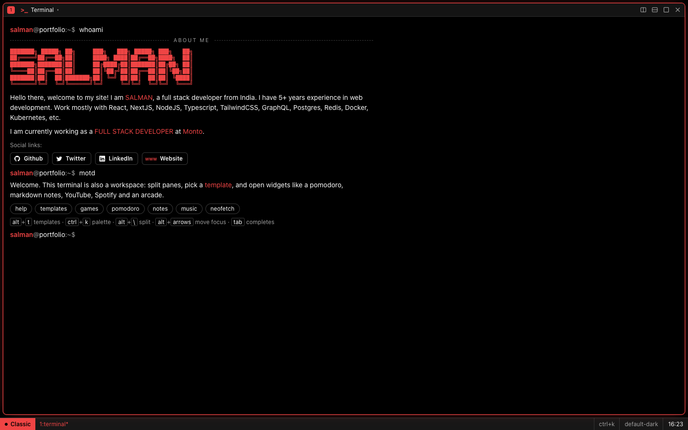
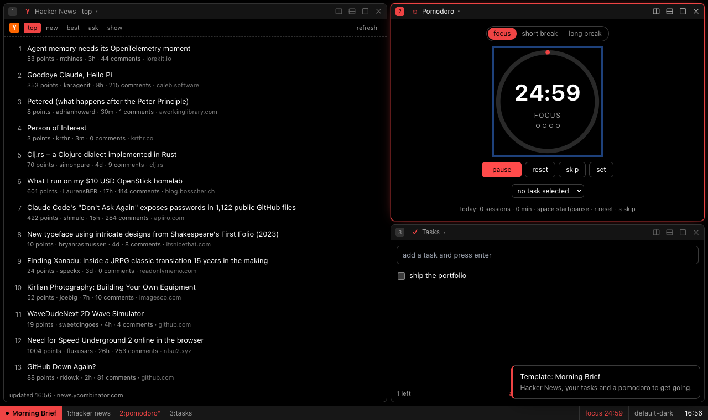
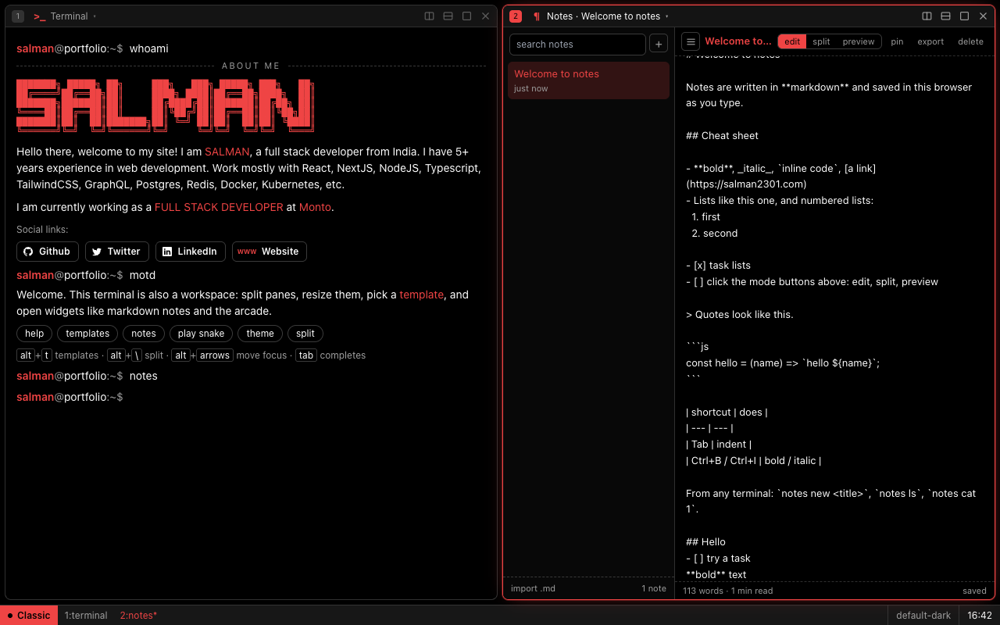
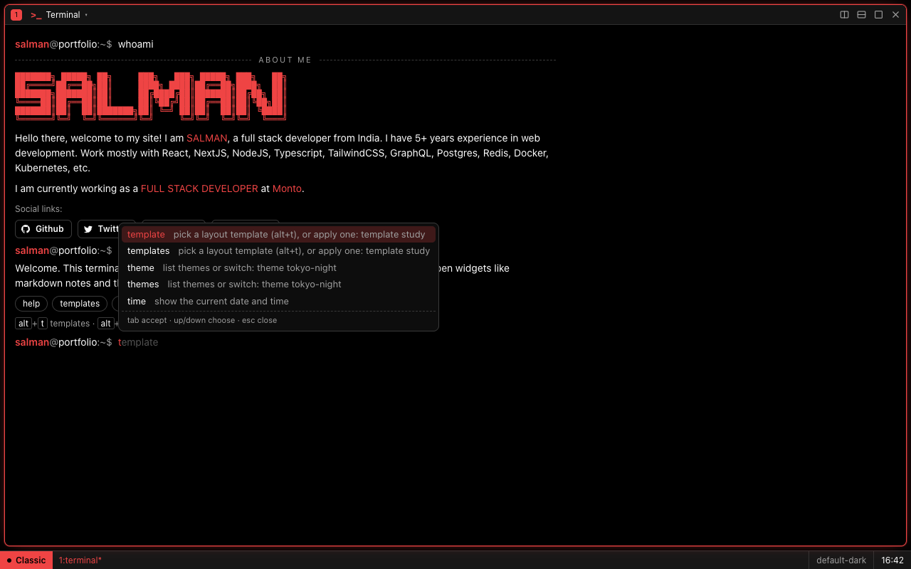
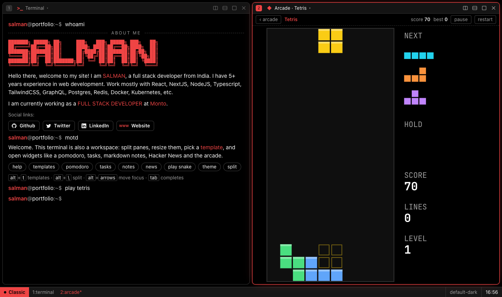
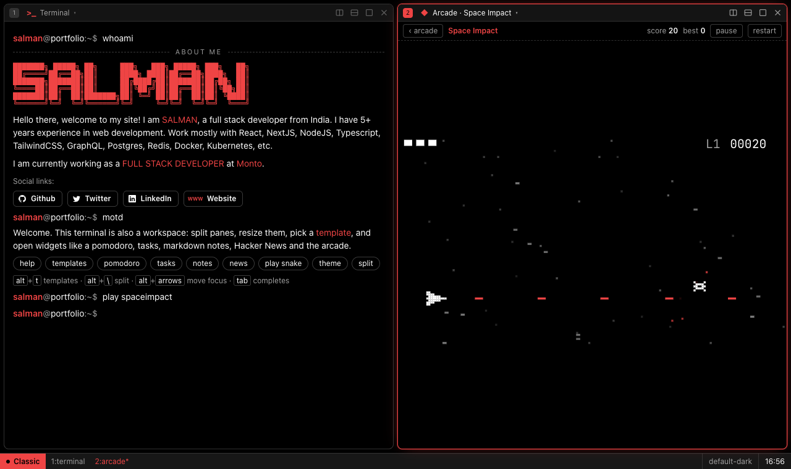
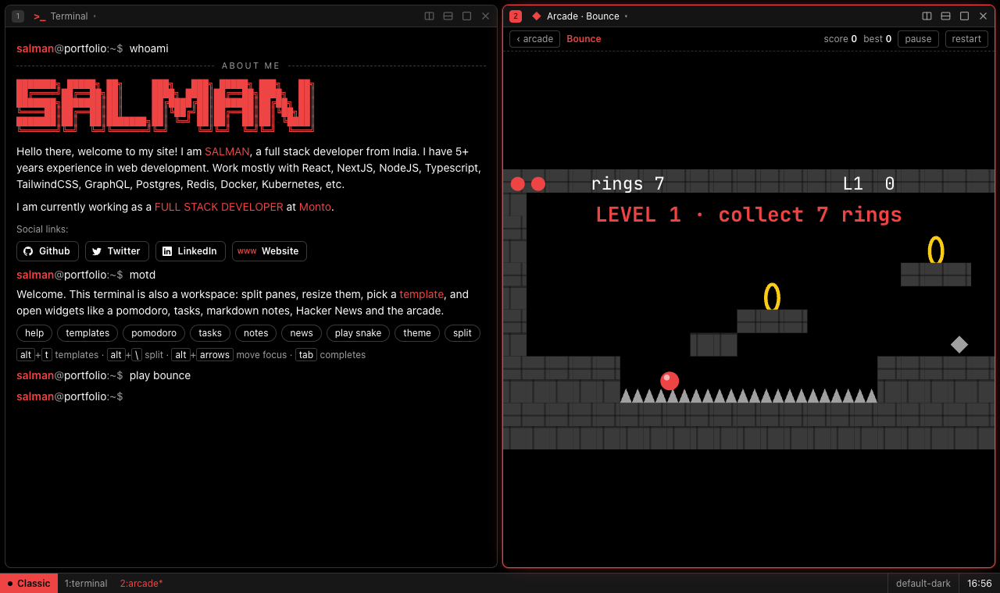
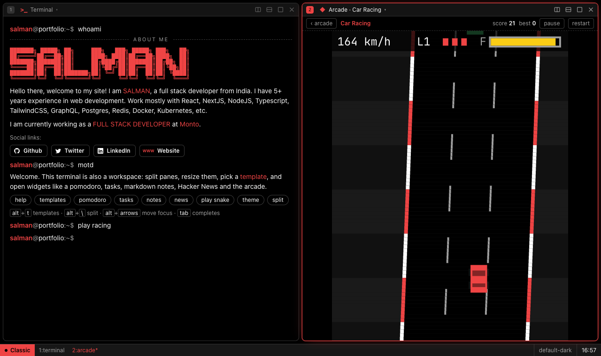

# salman2301.github.io

A terminal portfolio that doubles as a tiling workspace. Live at **[salman2301.github.io](https://salman2301.github.io)**.

Type `help` in the terminal to see every command.



## Screenshots

| Morning Brief template | Markdown notes |
| --- | --- |
|  |  |

| Autocomplete | Tetris |
| --- | --- |
|  |  |

| Space Impact | Bounce | Car Racing |
| --- | --- | --- |
|  |  |  |

## What's inside

- **Tiling panes**: split, resize (drag or keyboard), maximize, drag a pane header onto another pane to swap them, and turn any pane into any widget from its title menu.
- **Templates**: pick a layout with `Alt+T` or `templates`, or save your own (`template save <name>`). More templates appear automatically as more widgets are added.
- **Widgets**: the terminal, pomodoro (`pomodoro`), tasks (`todo`), Hacker News (`news`), markdown notes (`notes`, edit / split / preview, import and export .md) and the arcade.
- **Arcade**: Snake, Tetris, Space Impact, Bounce and Car Racing, with saved high scores (`games`, `play tetris`). WASD or arrows everywhere, Space pauses and resumes.
- **Extras**: 16 themes (`theme`), share links that recreate a layout (`share`), a tmux-style status bar, tab completion with inline suggestions, command chaining with `&&`.

Everything is saved in your browser's local storage. Nothing is sent to a server.

## Shortcuts

| Keys | Action |
| --- | --- |
| `Alt+T` | template picker |
| `Alt+\` or `Alt+Enter` | split right |
| `Alt+-` | split down |
| `Alt+W` | close pane |
| `Alt+M` | maximize / restore |
| `Alt+N` | new tab (window) |
| `Alt+[` / `Alt+]` | previous / next tab |
| `Alt+Y` | next theme |
| `Alt+Shift+Y` | random theme |
| `Alt+Arrows` | move focus between panes |
| `Alt+1..9` | focus pane by number |
| `Tab`, `Up`/`Down`, `Ctrl+C`, `Ctrl+L` | terminal completion, history, stop, clear |

On macOS, `Alt` is the `Option` key.

## Development

```sh
yarn install
yarn dev        # start the dev server
yarn run check  # type check
yarn build      # production build into dist/
```

Pushing to `master` builds the site and deploys it to the `gh-pages` branch.

### Adding things

Features are discovered automatically. You never edit a central list.

| Add a... | Create | Export |
| --- | --- | --- |
| widget | `src/lib/widgets/<id>/index.ts` | `WidgetDef` |
| game | `src/lib/games/<id>/index.ts` | `GameDef` (hosted by `GameShell`) |
| command | `src/lib/commands/<name>.ts` | `CommandDef` or `CommandDef[]` |
| overlay | `src/lib/overlays/<id>/index.ts` | `OverlayDef` |
| template | `src/lib/core/templates.ts` | `TemplateDef` |

The contracts are documented in `src/lib/core/types.ts`.
