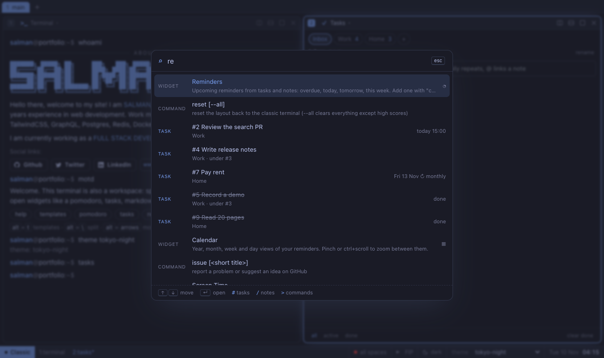
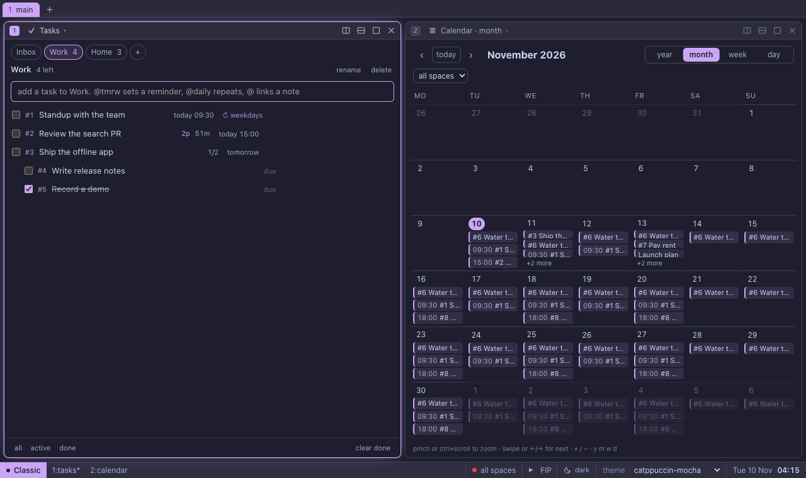
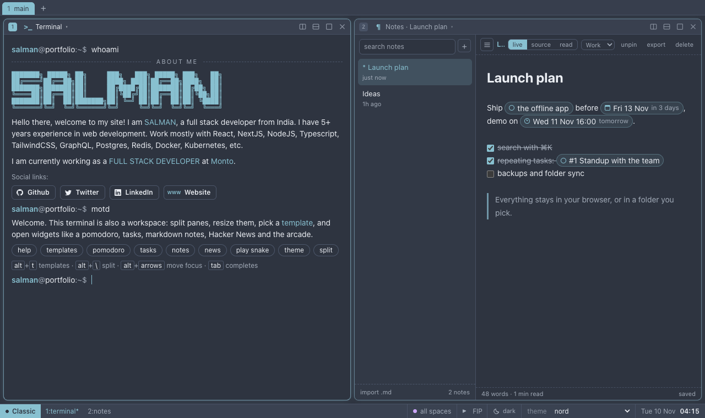
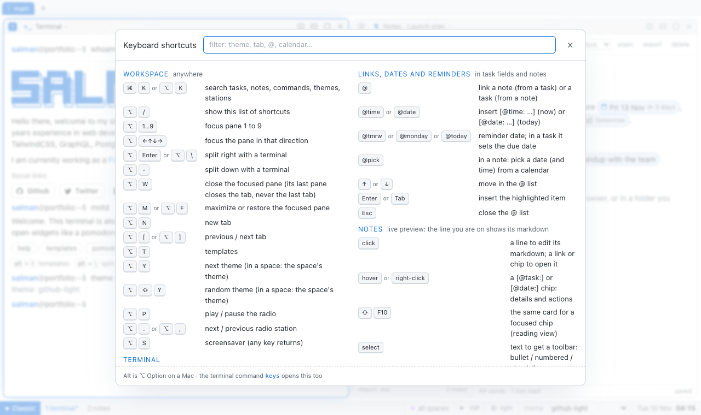
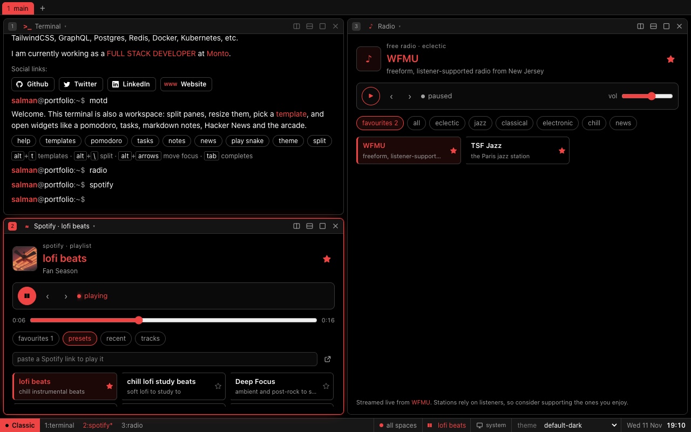
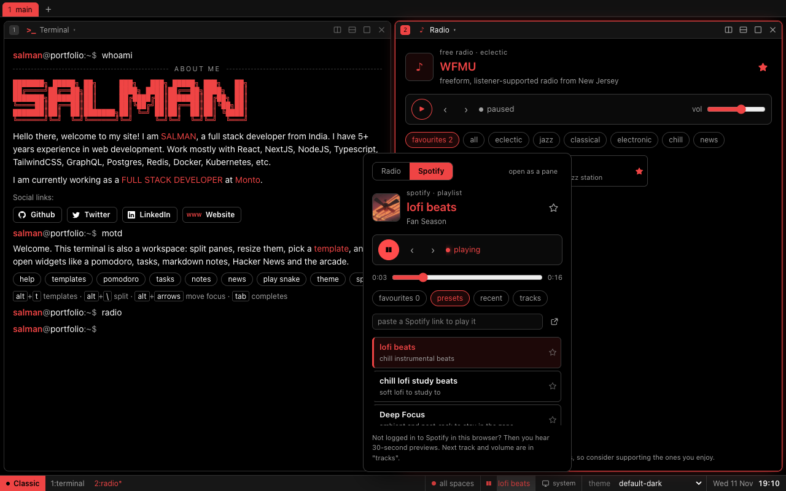
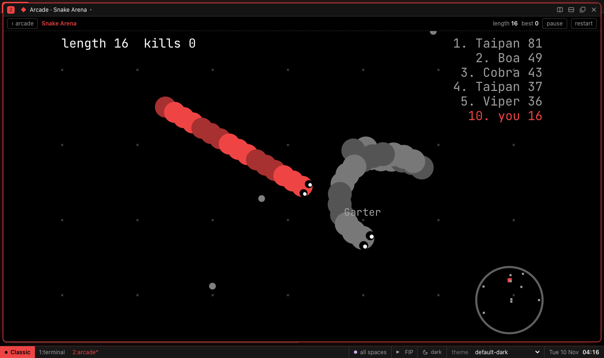
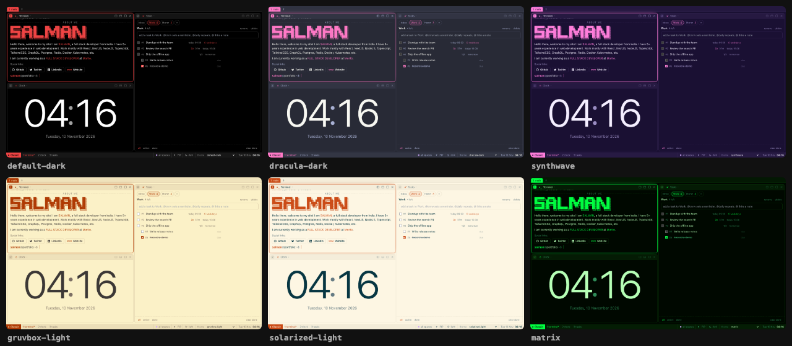

# salman2301.github.io

A terminal portfolio that doubles as a tiling workspace. Live at **[salman2301.github.io](https://salman2301.github.io)**.

Type `help` in the terminal to see every command.


## Screenshots

| Search everything (⌘K) | Tasks and calendar |
| --- | --- |
|  |  |

| Notes with links and dates | Keyboard shortcuts (Alt+/) |
| --- | --- |
|  |  |

| Morning Brief template | Markdown notes |
| --- | --- |
|  |  |

| Radio and Spotify, one look | Music panel in the status bar |
| --- | --- |
|  |  |

| Snake Arena | Autocomplete |
| --- | --- |
|  |  |

| Space Impact | Bounce | Car Racing | Tetris |
| --- | --- | --- | --- |
|  |  |  |  |

## What's inside

- **Tiling panes**: split, resize (drag or keyboard), maximize, drag a pane header onto another pane to swap them, and turn any pane into any widget from its title menu.
- **Templates**: pick a layout with `Alt+T` or `templates`, or save your own (`template save <name>`). More templates appear automatically as more widgets are added.
- **Widgets**: the terminal, pomodoro (`pomodoro`), tasks (`todo`), Hacker News (`news`), markdown notes (`notes`: Obsidian-style live preview where the line you are on shows its markdown and the rest stays rendered, plus source and reading views; select text for a toolbar that makes bullet, numbered or check lists and folds lines into an accordion; import and export .md) and the arcade.
  - **Tasks** (`todo`): tasks in spaces, sub-tasks, notes on tasks and spaces, a number for every task (`#12`, `todo focus 12`). Type `@` in a task or a note to link the other one, written as `[@task: #123]` or `[@note: Title]`; click a link to jump to it. Dates are written `[@date: 2026-11-28]` and `[@time: 2026-11-28 15:20]` (`@date`, `@time`, `@today`, `@tmrw`, `@monday` … `@sunday`, `@nextweek`, or pick one from a calendar). In a task a date sets its due date (`todo add pay rent @friday` works too); in a note it adds a reminder. The notes preview shows these as chips: tasks with a completed / active marker, dates with "in 3 days"; hover or right-click a chip for details and actions. Reminders show in the status-bar calendar, for all spaces or one, and pop a toast when due.
  - **Spaces** (`space work`, `space all`, or the status bar): group tasks and notes into spaces (Inbox is the default). Each tab is pinned to a space from the status bar (other tabs keep their own): it shows only that space's tasks, notes and reminders, in the space's own theme if it has one. Tasks move between spaces from their row (or `todo mv 12 work`). Rename, theme or delete a space from the same menu. Notes can be dragged to reorder.
  - **Screen time** (`screentime`, `open screentime`): how long you use the site, per day (7 or 30 days), and today by widget, space and hour. Counted only while the page is visible and you are active; kept in this browser.
  - **Repeating tasks**: `@daily`, `@weekdays`, `@weekly`, `@monthly`, `@yearly`, `@every monday`, `@every mon, wed`, `@every 2 weeks`, each with an optional time (`standup @daily 9:00`, `gym @every mon, wed 6pm`), or the repeat menu under a task's due date. Ticking one moves it to its next time (its sub-tasks open again) instead of finishing it, and the calendar shows the times ahead.
  - **Reminders** (`open reminders`): upcoming reminders grouped as overdue, today, tomorrow, this week and later; add one with `call mom @tmrw`.
  - **Calendar** (`calendar`, `cal week`): year, month, week and day views of your reminders. Pinch (touch or trackpad) or ctrl+scroll to zoom between them with an animated zoom into the spot you pinched; swipe or ←/→ for the next page. Click an hour in the day view to add a reminder there.
  - **Clock** (`clock`): calm by default, just the time and date; hover for digital / analog and 12 / 24h (digital), and "cities" for world clocks (`clock add Asia/Tokyo`).
  - **Timer** (`timer 5m`, `stopwatch`): stopwatch with laps, and a countdown that still rings when its pane is closed.
  - **Music**: **Radio** (`radio`, `radio list`) has 36 free live stations by genre (FIP, Radio Paradise, NTS, WFMU, jazz, classical, lo-fi, news), and **Spotify** (`spotify <link>`, `spotify lofi`) plays playlists, albums and shows. Both are drawn in your theme with the same controls, keep playing when you switch tabs or close the pane, and only one plays at a time. Star stations and playlists to build a favourites list (`radio fav`, `spotify fav`); next and previous step through the list you chose. The status bar has play / pause (`Alt+P`), and its name opens the full controls for both.
  - **Digital Rain** (`open matrix`) and **Embed** (`embed <url>`) for any page that allows it.
- **Arcade**: Snake, Snake Arena, Tetris, Space Impact, Bounce, Car Racing, Brick Breaker, Byte Runner, Typing Defense, Pairs and Sudoku, with saved high scores (`games`, `play sudoku`). WASD or arrows everywhere, Space pauses and resumes, and touch screens get an on-screen pad. A run counts even if you restart, leave or close it before game over, and high scores only ever go up: `reset --all`, backups and sync never lower them.
  - **Snake Arena** (`play arena`): steer with the mouse or A/D, hold click or W to boost (it costs length), eat to grow, and make other snakes run into you. Nine bots look ahead for bodies and walls, keep to open space, run from bigger snakes and hunt smaller ones by running alongside and cutting in front.
  - **Car Racing**: other cars signal before they change lanes and glide across, never crash into each other, and never line up across all three lanes, so there is always a way through.
- **Search** (`⌘K` / `Ctrl+K`, `Alt+K`, or `search`): one box over tasks, notes, commands, widgets, games, themes, radio stations and spaces. `#` narrows to tasks (`#12` jumps to task 12), `/` to notes, `>` to commands; `theme nord` or `>radio fip` runs the line in a terminal.
- **Backup and sync**: `backup` saves everything (tasks, notes, spaces, settings, layout) to a JSON file and `backup import` loads one, in any browser. `sync folder` keeps the same data in one file, `salman2301-workspace.json`, in a folder you pick; put that folder in iCloud Drive, Dropbox, Google Drive, OneDrive or Syncthing and every computer that picks it shares your data. Changes save a few seconds after you make them, a newer file loads when you open the site, and if both sides changed you choose with `sync pull` or `sync push`. Nothing goes to a server. Folder sync needs Chrome, Edge, Brave or Opera on a computer; `sync --help` explains it all.
- **Help and feedback**: any command explains itself with `--help` (or `help <command>`). `issue` opens a GitHub issue with your browser and screen size filled in.
- **Installable app**: install it from the browser (or run `install`) for its own window and offline use; reminders become system notifications while it runs in the background.
- **Extras**: 26 themes, including popular VS Code ones (One Dark Pro, GitHub, Night Owl, Monokai Pro, Ayu, Palenight, Cobalt2, Shades of Purple), with a system / dark / light switch in the status bar (`theme system`), share links that recreate a layout (`share`), screensavers in your theme that fill the pane (`screensaver matrix|stars|pipes|bounce`, `Alt+S`, or after idle minutes), `hack` (a fake breach in the terminal that ends in digital rain over the pane), a tmux-style status bar, tab completion with inline suggestions, command chaining with `&&`.

Everything is saved in your browser's local storage. Nothing is sent to a server; `sync` only writes to a folder on your own computer.

## Themes



26 themes, each built from five colours that every widget, game, screensaver and even the favicon use. Nothing has its own colours, so everything always matches.

| Dark | Light |
| --- | --- |
| `default-dark`, `tokyo-night`, `catppuccin-mocha`, `nord`, `atom-dark`, `dracula-dark`, `gruvbox-dark`, `material-dark`, `monokai-dark`, `solarized-dark`, `matrix`, `synthwave`, `one-dark-pro`, `github-dark`, `night-owl`, `monokai-pro`, `ayu-dark`, `palenight`, `cobalt2`, `shades-of-purple` | `default-light`, `atom-light`, `gruvbox-light`, `solarized-light`, `github-light`, `ayu-light` |

- **Pick one**: the theme menu in the status bar, `theme` (a clickable list with swatches), `theme <name>`, `Alt+Y` for the next one, or `Alt+Shift+Y` for a random one.
- **System, dark or light**: the sun/moon button in the status bar, or `theme system|dark|light`. You keep one favourite dark theme and one light theme, and `system` switches between them with your OS.
- **A theme per space**: in a tab pinned to a space, the theme keys and pickers set that space's own theme (the Work space can be `tokyo-night` while Home stays `gruvbox-light`). Under "all spaces" they change your normal theme.
- **Favicon**: the tab icon is redrawn in the current theme.

## Keyboard shortcuts

`Alt+/` (or `keys`) shows all of these in the app, with a filter. On macOS, `Alt` is `⌥ Option` and `Mod` is `⌘`; elsewhere `Mod` is `Ctrl`.

**Anywhere**

| Keys | Action |
| --- | --- |
| `Mod+K` or `Alt+K` | search tasks, notes, commands, widgets, themes, stations |
| `Alt+/` | the shortcut sheet |
| `Alt+1` … `Alt+9` | focus pane 1 to 9 |
| `Alt+←↑↓→` | focus the pane in that direction |
| `Alt+Enter` or `Alt+\` | split right with a terminal |
| `Alt+-` | split down with a terminal |
| `Alt+W` | close the focused pane (the last pane closes its tab, never the last tab) |
| `Alt+M` or `Alt+F` | maximize or restore the focused pane |
| `Alt+N` | new tab |
| `Alt+[` / `Alt+]` | previous / next tab |
| `Alt+T` | templates |
| `Alt+Y` / `Alt+Shift+Y` | next / random theme (in a space: the space's theme) |
| `Alt+P` | play / pause the music (radio or Spotify, whichever you used last) |
| `Alt+.` / `Alt+,` | next / previous station or playlist |
| `Alt+S` | screensaver (any key returns) |

**Terminal**

| Keys | Action |
| --- | --- |
| `Tab` | complete the command or argument |
| `↑` / `↓` | command history |
| `Ctrl+C` / `Ctrl+L` / `Ctrl+U` | stop the command / clear the screen / clear the line |
| `&&` | chain commands: `theme nord && clear` |
| `<command> --help` | explain any command (`help <command>` too) |

**Tasks** (with a task row focused)

| Keys | Action |
| --- | --- |
| `↑` / `↓` | move between tasks (`↓` from the input too) |
| `Space` | done / not done (a repeating task moves to its next time) |
| `Enter` | rename |
| `Delete` or `Backspace` | delete the task and its sub-tasks |
| `S` / `N` | add a sub-task / open its notes |
| `F` | focus on it: starts the pomodoro (again to stop) |
| `M` | move it to another space |

**Links, dates, reminders and repeats** (in task fields and notes)

| Type | Does |
| --- | --- |
| `@` | link a note (from a task) or a task (from a note) |
| `@time` / `@date` | insert the current time or today's date |
| `@today`, `@tmrw`, `@monday` … `@sunday`, `@nextweek` | a reminder date; in a task it sets the due date |
| `@daily`, `@weekdays`, `@weekly`, `@monthly`, `@yearly`, `@every mon, wed`, `@every 2 weeks` (plus a time: `@daily 9:00`) | a repeating task |
| `@pick` | in a note: pick a date (and time) from a calendar |

**Notes** (live preview: the line you are on shows its markdown)

| Keys | Action |
| --- | --- |
| select text | a toolbar: bullet / numbered / check list, accordion |
| `Mod+Shift+8` / `7` / `9` | bullet / numbered / check list (again to undo) |
| `Mod+B` / `Mod+I` | bold / italic |
| `Mod+Z` / `Mod+Shift+Z` | undo / redo |
| `Mod+S` | save now |
| hover or right-click a chip | task or date details and actions (`Shift+F10` from the keyboard) |

**Calendar** (focused): pinch or `Ctrl`+scroll zooms between year, month, week and day; `+` / `-` zoom; `Y` `M` `W` `D` pick a view; `←` / `→` or swipe for the next page; `T` for today.

**Clock** (focused): `A` digital / analog, `H` 12h / 24h. **Games**: WASD or arrows move, `Space` pauses.

**On a phone**: swipe left or right between panes, tap the chips in the bottom bar, and use **+** for everything the `Alt` keys do; see [On a phone](#on-a-phone).

## Advanced setup

### Install it as an app

Run `install`, or use the install icon in the address bar (Chrome, Edge), **File > Add to Dock** (Safari on a Mac), or **Share > Add to Home Screen** (iPhone, iPad). The app gets its own window, opens offline (every file is cached the first time you visit), and reminders show as system notifications while it is open in the background. After an update you get a "new version" note; reload to use it.

### On a phone

Below 720px wide the workspace switches to a phone layout:

- **One pane per screen.** Swipe left or right to move between panes, or tap a pane's chip in the bar at the bottom. Each pane scrolls its own content; the page itself never scrolls.
- **+** opens a sheet with every widget, and the actions that are `Alt` shortcuts on a computer (templates, new terminal, close pane, new tab, themes, music, screensaver, install, backup).
- **Search** is the magnifier next to it.
- **Typing**: the layout shrinks to the part of the screen above the keyboard and the bottom bars step aside, so the prompt or field you are in stays visible. Fields are never focused on their own, so swiping does not pop the keyboard up.
- **Terminal key row**: `tab`, `↑`, `↓`, `→`, `esc`, `^C`, `^L` and `^U` sit under the prompt, since phone keyboards do not have them.
- Games keep their on-screen pad, and the calendar keeps pinch to zoom and its own swipe for the next page (swipe on the pane's title bar or use the chips to change pane there).

### Sync between computers

Everything lives in your browser. To use the same tasks, notes and settings on another computer:

1. Run `sync folder` and pick a folder that a sync app shares: iCloud Drive, Dropbox, Google Drive, OneDrive or Syncthing.
2. On the other computer, open the site, run `sync folder` and pick the same folder.

The data is one file, `salman2301-workspace.json`. Changes are written a few seconds after you make them, and a newer file loads when you open the site or come back to it. If both sides changed, nothing is overwritten: run `sync pull` to use the folder's copy or `sync push` to keep this one. `sync` shows the status, `sync auto off` makes it manual, and `sync off` stops. If the browser asks again on a later visit, click **⟳ sync folder** in the status bar. Folder sync needs Chrome, Edge, Brave or Opera on a computer; `sync --help` explains it all.

### Backups

`backup` saves everything to a JSON file and `backup import` loads one (it asks first). This works in every browser, so it is also how you move data to Safari, Firefox or a phone. High scores are never lowered by a restore.

### Spaces and tabs

Spaces group tasks, notes and reminders (`space new Work`, `space Work`, or the status bar). Each tab is pinned to its own space, so one tab can show Work in `tokyo-night` while another shows everything. Tabs: `Alt+N`, `tab rename <name>`, `tab go 2`.

### Layouts and templates

`Alt+T` or `templates` picks a layout. Arrange panes the way you like (split, resize, drag a pane header onto another to swap them), then `template save <name>`; `template list` and `template delete <name>` manage them. `share` copies a link that rebuilds the current layout anywhere.

### Small settings

| Command | Does |
| --- | --- |
| `screensaver idle 10` / `screensaver idle off` | start a screensaver after 10 idle minutes, or never |
| `screensaver matrix` | show a screensaver now and use it when idle (`stars`, `pipes`, `bounce`, `random`) |
| `sound on` / `sound off` | sound effects and reminder chimes |
| `clock add tokyo` | a world clock (a city or a zone like `Asia/Tokyo`) |
| `pomodoro 50/10/20` | focus / short break / long break minutes |
| `radio fip` | tune in to a station; the status-bar player remembers it |
| `radio fav`, `radio favs` | star the current station; list your favourites and step through them |
| `spotify lofi`, `spotify fav` | play a preset or a link; star what is loaded |
| `reset` / `reset --all` | the classic layout / clear everything (high scores stay) |
| `issue` | report a problem on GitHub, with your browser filled in |

## Development

```sh
yarn install
yarn dev        # start the dev server
yarn run check  # type check
yarn build      # production build into dist/
```

Pushing to `master` builds the site and deploys it to the `gh-pages` branch.

### Run your own copy

1. Fork this repository and rename it to `<your-user>.github.io` (the site is built for the root of a domain).
2. In the fork's **Settings > Pages**, serve from the `gh-pages` branch.
3. Push to `master`: the `Deploy to GitHub Pages` workflow builds and publishes it.
4. Make it yours: the about-me text is in `src/lib/terminal/output/Whoami.svelte`, the prompt name in `src/lib/terminal/context.ts`, and themes in `src/lib/core/theme.ts` (five colours each: background, panel, accent, muted text, text).

The service worker is only built for production (`yarn build`); `yarn dev` runs without it.

### Adding things

Features are discovered automatically. You never edit a central list.

| Add a... | Create | Export |
| --- | --- | --- |
| widget | `src/lib/widgets/<id>/index.ts` | `WidgetDef` |
| game | `src/lib/games/<id>/index.ts` | `GameDef` (hosted by `GameShell`) |
| command | `src/lib/commands/<name>.ts` | `CommandDef` or `CommandDef[]` |
| overlay | `src/lib/overlays/<id>/index.ts` | `OverlayDef` |
| template | `src/lib/core/templates.ts` | `TemplateDef` |

The contracts are documented in `src/lib/core/types.ts`.
